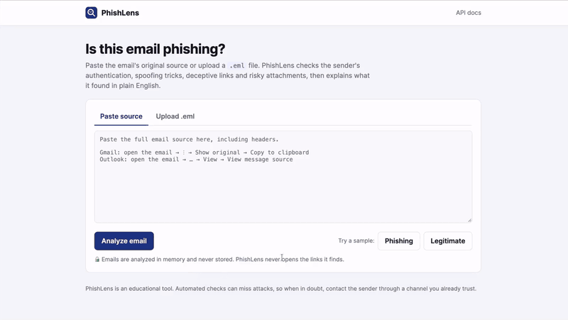
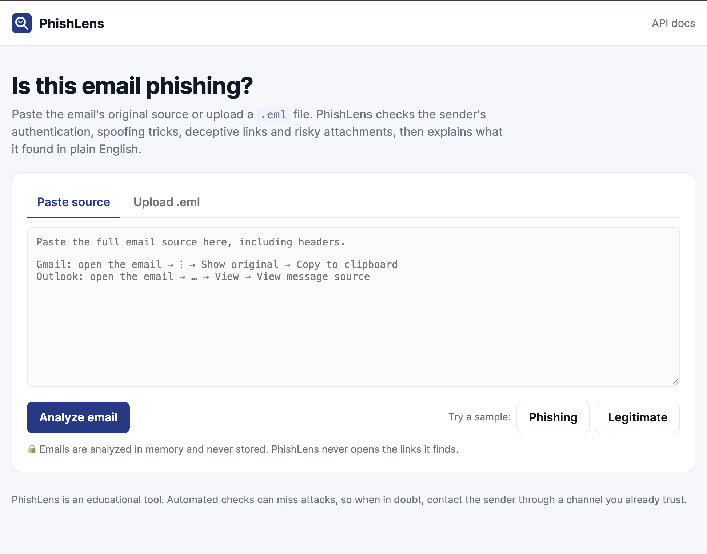
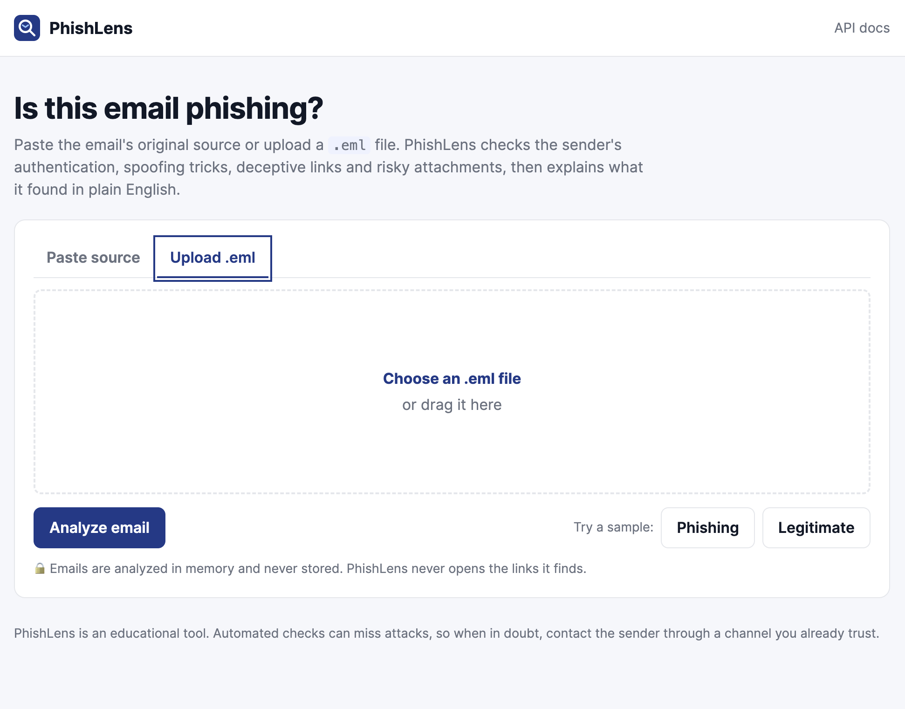
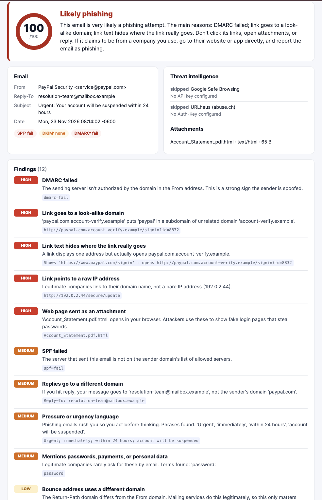
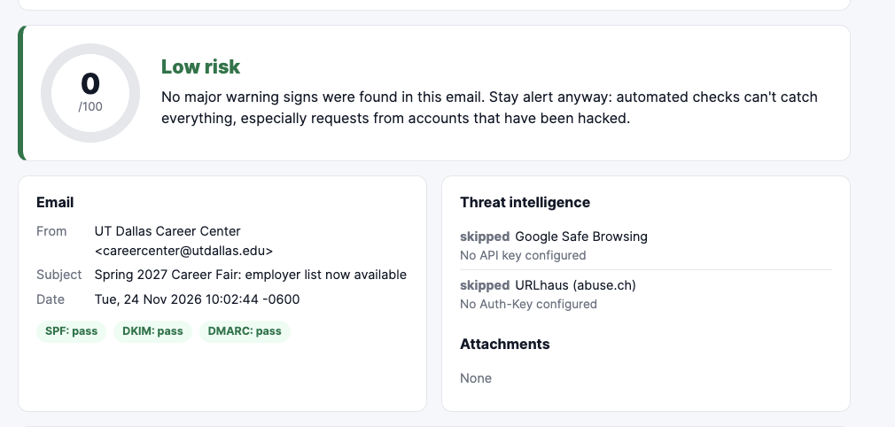
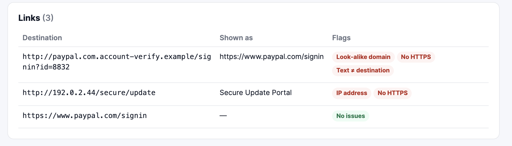
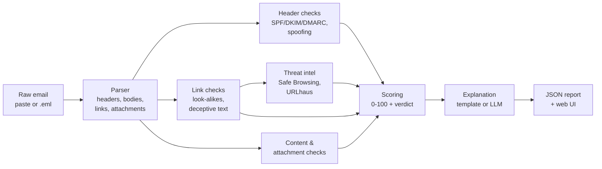

# 🔍 PhishLens: Explainable Phishing Email Analyzer

[](https://github.com/mijyroid/phishlens/actions/workflows/ci.yml)


**Built by:** Joyce J. · Software Engineering, The University of Texas at Dallas

**🌐 Live demo:** _coming soon_ · **📘 API docs:** `/docs` on any running instance

PhishLens tells you whether an email is phishing **and shows you why**. Paste an email's original source or upload a `.eml` file, and it checks the sender's authentication, spoofing tricks, deceptive links, risky attachments and threat-intelligence feeds. You get a 0–100 risk score, every warning sign it found with the evidence behind it, and a plain-English summary of what to do next.

## Demo

https://github.com/user-attachments/assets/ec4ce3cb-e8fc-4b0f-83dc-3d9ddb7703bc



_Analyzing the built-in phishing sample (100/100) and a legitimate university email (0/100), then uploading a fake USPS delivery scam as an `.eml` file (100/100)._

## Why I built this

My parents often can't tell a real email from a phishing one. The usual advice, like "check the sender's domain" or "hover over the link first," assumes technical knowledge they don't have, and scam emails are designed to look exactly like the real thing. Older adults are some of the people scammers target most.

I built PhishLens so anyone can get a clear answer without needing to understand email. It gives a simple verdict, explains each warning sign in everyday language, and says exactly what to do next. Because it explains its reasoning instead of just saying "safe" or "unsafe," people also learn to spot the next scam on their own.

## Previews

<table>
  <tr>
    <td width="50%"><b>Paste an email's original source</b><br></td>
    <td width="50%"><b>Or upload an .eml file</b><br></td>
  </tr>
  <tr>
    <td width="50%"><b>Phishing verdict: risk score, sender checks and every finding with its evidence</b><br></td>
    <td width="50%"><b>Legitimate email: low risk</b><br><br><br><b>Each link's real destination and red flags</b><br></td>
  </tr>
</table>

## Features

### Core features

- [x] **Sender authentication:** reads the SPF, DKIM and DMARC results recorded by the recipient's mail server
- [x] **Spoofing detection:** brand names in the display name sent from unrelated or free-webmail domains, email addresses hidden in the display name, and Reply-To or Return-Path addresses pointing elsewhere
- [x] **Look-alike domain detection:** typosquats (`paypa1.com`, `arnazon.com`), brand-plus-word domains (`paypal-secure-login.com`), brand names hidden in subdomains (`paypal.com.verify-account.example`) and punycode
- [x] **Link analysis:** link text that shows one address but opens another, raw IP addresses, `user@host` URL tricks, URL shorteners, `javascript:` links, forms embedded in the email, risky TLDs and plain HTTP
- [x] **Content analysis:** urgency and pressure language, requests for passwords, payments or personal data, and generic greetings
- [x] **Attachment analysis:** executables, double extensions (`invoice.pdf.exe`), HTML attachments used as fake login pages, macro-enabled Office files and archives
- [x] **Risk scoring:** every finding has a severity (info to critical) that adds up to a 0–100 score and a verdict: *low risk* (under 25), *suspicious* (25–59) or *likely phishing* (60+)
- [x] **Plain-English explanation** of the verdict and what to do next
- [x] **Web UI** with paste and drag-and-drop `.eml` upload, plus built-in sample emails to try
- [x] **REST API** with interactive Swagger docs

### Optional integrations

- [x] **Google Safe Browsing** lookups for every link
- [x] **URLhaus (abuse.ch)** malware-URL lookups
- [x] **AI-written explanation** using Claude, built so the model only sees the findings, never the email itself

Each integration turns on when its API key is set. Without keys, every built-in check still runs and the report marks those sources as skipped.

## Security and privacy by design

PhishLens processes content written by attackers, so it's built defensively:

| Risk | How PhishLens handles it |
|---|---|
| Leaking private emails | Analysis happens in memory. Emails are never stored or logged. |
| Being tricked into visiting malicious sites (SSRF) | PhishLens never opens links. It only sends URLs to reputation services. |
| Sending private content to an AI | The LLM receives only the findings, subject and sender, never the body. |
| Malicious email content attacking the UI (XSS) | Every email-derived value is rendered with `textContent`, and a strict Content-Security-Policy blocks inline scripts. |
| Abuse and oversized uploads | 2 MB request limit and per-IP rate limiting. |
| A third-party service going down | Each lookup fails safe: the report shows the error and all local checks still run. |
| Container compromise | The Docker image runs as a non-root user. |

## How it works



## Tech stack

| Layer | Tools |
|---|---|
| Backend | Python 3.11+, FastAPI, Pydantic, Uvicorn, httpx (async) |
| Frontend | HTML, CSS, vanilla JavaScript (no build step) |
| Threat intel | Google Safe Browsing API, URLhaus API |
| AI | Anthropic Claude API (optional) |
| Testing and quality | pytest (59 tests), Ruff |
| DevOps | Docker, GitHub Actions CI, Render |

## Quick start

Requires Python 3.11 or newer.

```bash
git clone https://github.com/mijyroid/phishlens.git
cd phishlens
python -m venv .venv
source .venv/bin/activate        # Windows: .venv\Scripts\activate
pip install -r requirements-dev.txt
uvicorn phishlens.main:app --reload
```

Open http://localhost:8000 and click **Try a sample: Phishing**.

### Optional API keys

Copy `.env.example` to `.env` or set these as environment variables:

| Variable | What it enables | Get one |
|---|---|---|
| `SAFE_BROWSING_API_KEY` | Google Safe Browsing link checks (free for non-commercial use) | [Google Cloud console](https://developers.google.com/safe-browsing/v4/get-started) |
| `URLHAUS_AUTH_KEY` | URLhaus malware-URL checks (free) | [abuse.ch Authentication Portal](https://auth.abuse.ch/) |
| `ANTHROPIC_API_KEY` | AI-written explanation | [Anthropic Console](https://console.anthropic.com/) |

### Run with Docker

```bash
docker build -t phishlens .
docker run -p 8000:8000 phishlens
```

### Deploy for free

The repo includes a `render.yaml` for [Render](https://render.com/)'s free tier:

1. In Render, click **New → Blueprint** and choose this repo.
2. Add any API keys when prompted, or leave them blank.
3. Deploy. Free services sleep after 15 minutes without traffic, so the first visit afterward takes about a minute.

## How to get an email's original source

- **Gmail:** open the email → ⋮ (More) → **Show original** → **Copy to clipboard**
- **Outlook (web):** open the email → … → **View** → **View message source**
- **Apple Mail:** open the email → **View** → **Message** → **Raw Source**

Pasting just the body works too, but the sender checks need the headers.

## Project structure

```
phishlens/
├── phishlens/
│   ├── parser.py          # parses raw email: headers, bodies, links, attachments
│   ├── checks/
│   │   ├── headers.py     # SPF/DKIM/DMARC and sender spoofing
│   │   ├── domains.py     # registrable domains and look-alike detection
│   │   ├── links.py       # per-link risk flags
│   │   └── content.py     # language and attachment checks
│   ├── intel.py           # async Safe Browsing and URLhaus lookups
│   ├── scoring.py         # severity weights → score and verdict
│   ├── explain.py         # template or LLM explanation
│   ├── analyzer.py        # runs every check and builds the report
│   ├── main.py            # FastAPI app and security middleware
│   ├── samples/           # demo emails (all domains are safe .example addresses)
│   └── static/            # web UI
├── tests/                 # 59 pytest tests
├── docs/                  # screenshots and demo video
├── .github/workflows/     # CI: lint, test, Docker build
├── Dockerfile
└── render.yaml
```

## API

| Method | Endpoint | Description |
|---|---|---|
| `POST` | `/api/analyze` | Analyze pasted source: `{"raw": "..."}` |
| `POST` | `/api/analyze/file` | Analyze an uploaded `.eml` file (multipart field `file`) |
| `GET` | `/api/samples/{phishing\|legitimate}` | Get a demo email |
| `GET` | `/api/health` | Health check and which integrations are enabled |

```bash
curl -X POST localhost:8000/api/analyze \
  -H "Content-Type: application/json" \
  -d '{"raw": "From: \"PayPal\" <alerts@paypa1.com>\nSubject: Verify now\n\nhttp://192.0.2.1/login"}'
```

```json
{
  "score": 95,
  "verdict": "likely_phishing",
  "explanation": "This email is very likely a phishing attempt. The main reasons: ...",
  "findings": [
    {
      "rule": "lookalike_sender_domain",
      "category": "sender",
      "severity": "high",
      "title": "Sender domain imitates a known brand",
      "detail": "'paypa1.com' swaps look-alike characters to imitate paypal.",
      "evidence": "paypa1.com"
    }
  ],
  "links": [{ "url": "http://192.0.2.1/login", "text": null, "domain": "192.0.2.1", "flags": ["ip_host", "http"] }],
  "intel": [{ "source": "Google Safe Browsing", "status": "skipped", "detail": "No API key configured" }]
}
```

## Testing

```bash
pytest          # 59 tests: parser, every check, scoring, threat intel (mocked), API
ruff check .    # lint
```

On every push, GitHub Actions lints and tests on Python 3.11, 3.12 and 3.13, then builds the Docker image and confirms it starts.

## Limitations

PhishLens uses heuristics and public threat feeds, so it can miss attacks, especially from hacked legitimate accounts, and it occasionally flags legitimate marketing email. Treat the score as a second opinion, not a guarantee.

## Future enhancements

- [ ] Chrome extension with a one-click "Check this email" button
- [ ] Domain age lookups, since newly registered domains are a strong phishing signal
- [ ] QR-code scanning in images to catch "quishing"
- [ ] Analysis history for signed-in users
- [ ] Batch analysis for IT teams reviewing reported emails

## License

Released under the [MIT License](LICENSE).
